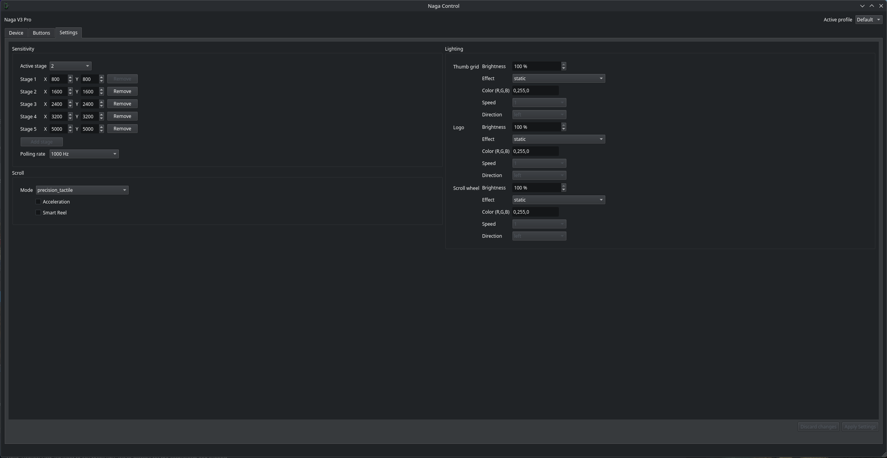
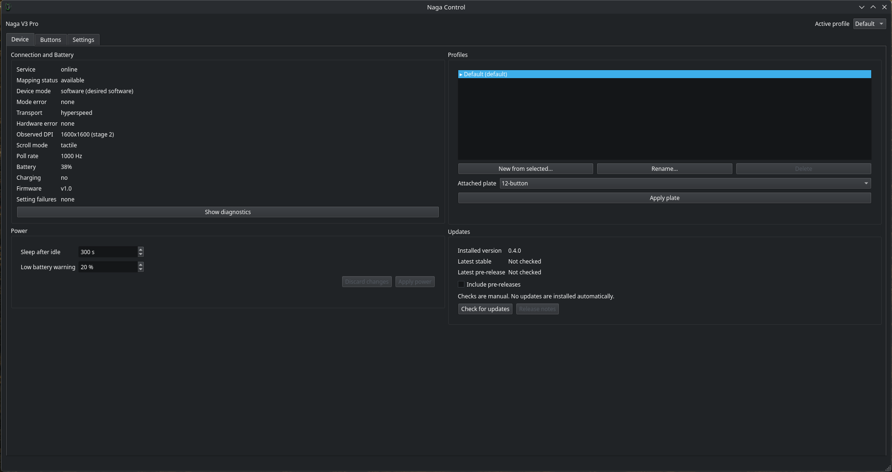
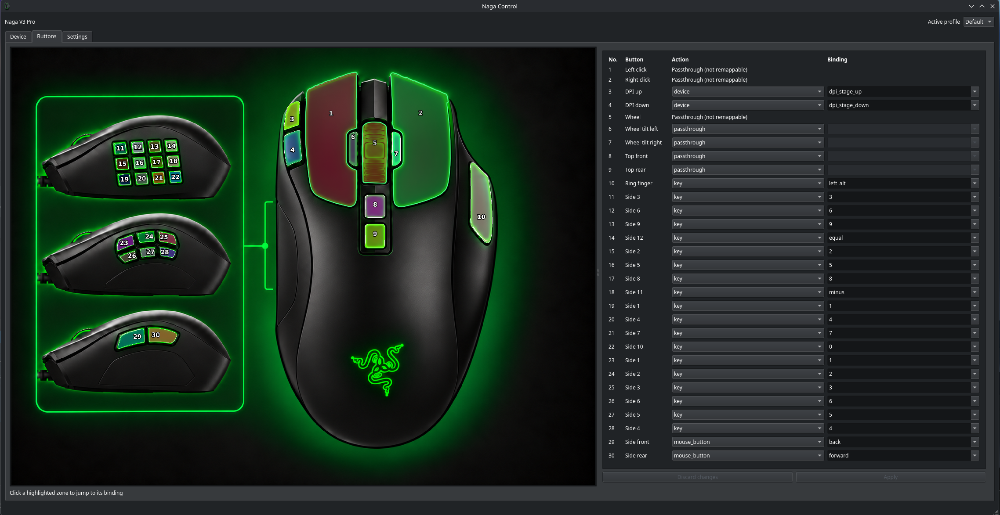

# Naga Control

Naga Control is a native Linux control service and Qt application for the
Razer Naga V3 Pro, limited to wired `1532:00E7` and HyperSpeed `1532:00E8`.
It uses OpenRazer for hardware operations plus evdev and uinput for button
remapping. It is not a generic Razer frontend.

A personal project, built for my own Razer Naga V3 Pro on Linux. Bug
reports, feedback, and contributions are welcome.



<details>
<summary>More screenshots</summary>





</details>

## Features

- Button remapping across the 12-, 6-, and 2-button side plates with manual
  plate selection.
- DPI stages (F13/F14 stage up/down), polling rate, scroll modes, and power
  settings via OpenRazer.
- Per-zone lighting for the thumb grid, logo, and scroll wheel, exposing only
  supported effects.
- Application (software) profiles with manual selection; mappings keep working
  when the GUI is closed.
- User systemd service with session D-Bus control and a PySide6 panel.

## Install

Requires Linux x86_64, a user systemd/session D-Bus desktop session, FUSE2
runtime support (`libfuse.so.2` plus `/dev/fuse`), `curl`, and `sudo` for
scoped operations only. See
[installer prerequisites](docs/troubleshooting.md#installer-prerequisites).
The AppImage targets the Ubuntu 22.04/glibc 2.35 floor on x86_64; this is a
build floor, not certification of every distribution.

Hardware use additionally needs a compatible custom OpenRazer kernel module,
daemon, and host Python client installed separately; the bundled runtime does
not include the backend. See
[required OpenRazer](docs/release-notes.md#required-openrazer).

Download the installer to a file, then run it. Do not pipe it into bash:

```bash
curl -fsSL https://raw.githubusercontent.com/Rainexn0b/naga-control/main/install.sh -o install.sh && bash install.sh
```

Rerun the same command to update a published release; it never installs
unreleased `main` source. The ordinary install is app-only by default: on
eligible hosts with an entirely absent backend it offers consented
first-install backend setup, while existing backends are left untouched and
no OS prerequisites are installed silently. For reproducible installation,
updates, and recovery, see the [installation guide](docs/installation.md)
and [upgrades and
recovery](docs/troubleshooting.md#installer-upgrades-and-rollback).

Before upgrading, quit the GUI and release held controls; remapping pauses
briefly during a consented service stop. Never run the installer, GUI, or
service as root. For a managed install leave `APPIMAGE_EXTRACT_AND_RUN`
unset (or `0`).

A successful install runs the service but establishes no physical-button
checks by itself; finish with the snapshot and F13/F14/F17 checks in
[upgrades and recovery](docs/troubleshooting.md#installer-upgrades-and-rollback).

## Run

Start the panel from your app menu or from a terminal:

```bash
~/.local/bin/naga-control
```

`naga-control` alone works when `~/.local/bin` is in `PATH`. Closing the GUI
does not stop mappings; the background service keeps running. Under Device >
Application you can start at login (tray) or restart only the Naga background
service after confirmation; that restart never touches OpenRazer. See
[desktop startup controls](docs/desktop-startup-controls.md).

## Safety and limitations

- Connect only one transport at a time: wired `1532:00E7` or HyperSpeed
  `1532:00E8`. Attaching both causes an OpenRazer identity conflict.
- Select the attached side plate manually under Device > Profiles. The 6- and
  2-button plates are HyperSpeed-only signatures; wired 6/2 plates are
  uncaptured and not enabled.
- Natural sleep/wake acceptance on the exact pinned backend is still pending;
  see [hardware validation](docs/hardware-validation.md).
- Profiles are software profiles, not onboard slots; onboard binding upload
  is not supported. Desired settings are applied to the hardware through
  OpenRazer. Firmware/driver mode switching stays gated pending safety
  validation.
- Driver mode `3:0` is required for mapped events. uinput access is a
  security-sensitive permission. Design details: [architecture](docs/architecture.md).

## Documentation

- [Installation guide](docs/installation.md): detailed install, pinning,
  updates, FUSE references, AppImage integration, uninstall.
- [Development](docs/development.md): source setup, checks, builds, and safe
  diagnostics.
- [Troubleshooting](docs/troubleshooting.md): prerequisites, upgrades and
  recovery, service checks.
- [Release notes](docs/release-notes.md): required OpenRazer baseline,
  hardware limits, and history ([changelog](changelog.md)).
- [Architecture](docs/architecture.md) and
  [implementation plan](docs/implementation-plan.md).
- [Hardware validation](docs/hardware-validation.md) and
  [integration findings](docs/integration-findings.md).

## Uninstall

Quit the GUI and release held controls first, then:

```bash
curl -fsSL https://raw.githubusercontent.com/Rainexn0b/naga-control/main/uninstall.sh -o uninstall.sh && bash uninstall.sh
```

Profiles stay unless `--purge-config` is passed; OpenRazer packages, group
membership, and daemon stay. Details: [installation guide](docs/installation.md).

## License

Naga Control is licensed under the [GNU General Public License v2.0 (GPL-2.0-only)](LICENSE),
matching OpenRazer which the project uses for all hardware operations, and is provided
without warranty as described in the license.
